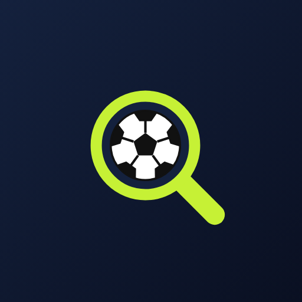

<p align="center"></p>

# TrackmyBoot ⚽

App Android para **monitorar ofertas de equipamentos de futebol**: camisas, chuteiras, bolas, meiões,
luvas de goleiro, caneleiras, calções, agasalhos e acessórios. Os preços vêm de várias lojas on-line,
e você pode filtrar tudo pelo **clube para quem torce**.

> Versão 0.1.0, a primeira. Kotlin, Jetpack Compose e Material 3. Android 8.0 (API 26) ou mais novo.

## Funcionalidades

| Aba | O que faz |
|-----|-----------|
| **Início** | Grade de categorias e atalhos para os seus clubes |
| **Clubes** | Busca de clubes e seleções pelo nome ou apelido ("Galo", "Timão", "SPFC"...). A ⭐ marca os clubes para quem você torce. Na tela do clube aparecem as ofertas dele, filtradas por categoria |
| **Buscar** | Busca livre em todas as lojas, com filtro por categoria |
| **Monitorados** | Produtos que você acompanha, com preço alvo opcional, menor preço visto e um gráfico do histórico. A cada 6 horas o app confere os preços de novo e manda uma notificação quando algum baixa |
| **Lojas** | Liga e desliga lojas. Também dá para **cadastrar lojas novas**, como a loja oficial do seu clube, se ela usar VTEX ou Shopify |

Em todas as listas você pode ordenar por maior desconto, menor preço ou maior preço.

## Como os preços são capturados

Cada loja usa um **conector** que depende da plataforma de e-commerce dela (`app/src/main/java/com/trackmyboot/app/data/source/`):

| Conector | Endpoint usado | Lojas embutidas |
|----------|----------------|-----------------|
| `VtexSource` | `/api/catalog_system/pub/products/search` | Centauro, FutFanatics, Decathlon, Penalty, Umbro, Topper |
| `ShopifySource` | `/search/suggest.json` e `/products/<handle>.js` | (lojas cadastradas pelo usuário) |
| `MercadoLivreSource` | `api.mercadolibre.com/sites/MLB/search` | Mercado Livre |
| `DemoSource` | — (dados fictícios) | "Ofertas de demonstração" |

- Todas as lojas ligadas são consultadas **em paralelo**. Quando uma falha ou demora mais de 20 s, as outras continuam, e a tela informa quais ficaram indisponíveis.
- Os resultados passam por um filtro de categoria e de clube. Os títulos são comparados sem acentos e com os apelidos de cada clube, para que "Camisa do Galo" conte como Atlético Mineiro e "interna" não conte como Inter.
- **Ofertas de demonstração** aparecem com o selo `DEMO`. Elas mantêm o app usável sem rede ou quando as lojas bloqueiam o acesso. Dá para escondê-las com a chave "Demo" na lista ou desligar a loja de demonstração na aba Lojas.

### ⚠️ Limitações conhecidas (leia antes de publicar)

- **A plataforma das lojas embutidas não foi verificada.** O ambiente de desenvolvimento não alcançava os sites das lojas. Os conectores foram escritos com base nas APIs públicas documentadas de VTEX, Shopify e Mercado Livre e testados contra respostas simuladas. Se uma loja não usar a plataforma indicada, ou se mudar de plataforma, ela vai aparecer como "indisponível". Para corrigir, basta editar `data/catalog/StoreCatalog.kt`.
- A API de busca do Mercado Livre pode exigir um token de acesso (OAuth). Sem ele, a loja aparece como indisponível.
- Algumas lojas bloqueiam acesso automatizado com captcha ou WAF. Antes de distribuir o app, revise os termos de uso de cada loja. Programas de afiliados ou APIs oficiais são um caminho mais estável.
- Não existe um conector genérico para lojas de clubes, porque cada clube usa uma plataforma diferente. Por isso o app permite cadastrar a loja oficial pelo endereço e vinculá-la ao clube. Ela então entra automaticamente nas buscas desse clube.

## Arquitetura

```
app/src/main/java/com/trackmyboot/app/
├── TrackmyBootApp.kt        # Application + AppContainer (injeção de dependências manual)
├── MainActivity.kt          # Navegação (Navigation Compose) e barra inferior
├── data/
│   ├── model/               # Category, Club, StoreInfo, Offer
│   ├── catalog/             # Lista de clubes e de lojas embutidas
│   ├── source/              # Conectores: VTEX, Shopify, Mercado Livre, Demo
│   ├── local/               # Room: produtos monitorados e histórico de preços
│   ├── prefs/               # DataStore: clubes favoritos, lojas ligadas, lojas personalizadas
│   ├── worker/              # WorkManager: conferência periódica e notificações
│   └── OfferRepository.kt   # Busca em paralelo, filtros, cache e monitoramento
├── ui/                      # Telas, componentes, tema e ViewModels
└── util/
```

## Ícone

O ícone foi criado para o app: uma **lupa verde-limão com uma bola de futebol dentro**, que representa buscar e comparar ofertas, sobre fundo azul-marinho. Arquivos:

- `res/drawable/ic_launcher_foreground.xml`, `ic_launcher_background.xml` e `ic_launcher_monochrome.xml` formam o ícone adaptativo e o ícone temático do Android 13+
- `res/drawable/ic_notification.xml` é o ícone das notificações (a lupa)
- `docs/icon.svg` e `docs/icon-512.png` servem para a Play Store e para divulgação

Os escudos dos clubes no app são **estilizados** (cores e iniciais), sem usar marcas registradas.

## Compilar e rodar

Requisitos: JDK 17 ou mais novo e o Android SDK 35 (ou o Android Studio Ladybug ou mais novo).

```bash
./gradlew assembleDebug        # gera app/build/outputs/apk/debug/app-debug.apk
./gradlew testDebugUnitTest    # testes unitários
./gradlew lintDebug
```

O CI do GitHub Actions roda os testes, o lint e gera o APK de debug como artefato a cada push.

## Próximos passos sugeridos

- Validar cada loja embutida em um aparelho real e ajustar `StoreCatalog`
- Token OAuth do Mercado Livre e conectores para outras plataformas (Magento, Salesforce Commerce)
- Backend próprio para capturar os preços no servidor, evitando bloqueios e economizando bateria
- Busca por tamanho e numeração, e comparação do mesmo produto entre lojas

## Licença

MIT. Veja [LICENSE](LICENSE).
